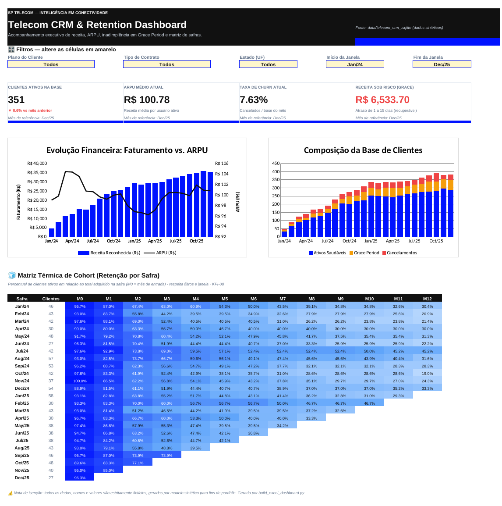

# CRM & Telecom Churn Analytics Pipeline
> **Projeto de Retenção de Clientes e CRM Analytics para Telecomunicações**

[](https://github.com/pauloavm/crm-telecom-retention-analytics/actions/workflows/ci.yml)

-brightgreen)

> ⚠️ **Dados 100% sintéticos** (gerados com `Faker` em `generate_database.py`). Empresa, clientes e valores são fictícios — o objetivo é demonstrar modelagem, engenharia e análise de retenção.

---

Este repositório contém um ecossistema de análise de dados de ponta a ponta projetado para mensurar a saúde da base de clientes ativos, quantificar riscos financeiros associados à inadimplência temporária e modelar a retenção de safras (análise de coorte).

🌐 **Acesse o Dashboard Online:** [https://crm-telecom.streamlit.app/](https://crm-telecom.streamlit.app/)

O grande diferencial deste pipeline é sua **arquitetura híbrida de alto desempenho**, oferecendo duas opções robustas de visualização:
1.  **Dashboard Web Interativo (Streamlit)**: Disponível diretamente no navegador, permitindo simulações e diagnósticos rápidos de forma totalmente responsiva.
2.  **Dashboard Executivo em Excel (`dashboards/dashboard_crm_telecom.xlsx`)**: o mesmo painel do Streamlit — cartões, gráficos, matriz de cohort e filtros — construído só com fórmulas nativas (sem macros). Abre em qualquer Excel, sem instalar nada.

Os dois painéis seguem a mesma especificação de KPIs ([`specs/kpis.spec.md`](specs/kpis.spec.md)) e os testes automatizados garantem que **mostram exatamente os mesmos números**.



---

## 🚀 Estrutura do Repositório

```bash
/
├── README.MD
├── requirements.txt         # Dependências do app (Streamlit Cloud)
├── requirements-dev.txt     # Dependências de teste/qualidade (pytest, Playwright, ruff)
├── pytest.ini
├── dicionario_dados.md      # Dicionário de dados detalhado
├── specs/
│   └── kpis.spec.md         # Especificação (SDD) das regras de negócio e KPIs — fonte da verdade
├── generate_database.py     # Gera a base sintética (Faker) em SQLite com a regra de Grace Period
├── ingestao_dados.py        # Migra o SQLite para MySQL (schema relacional + carga)
├── generate_table_view.py   # Executa os modelos de /sql e materializa as tabelas resumo (MySQL ou --sqlite)
├── analytics.py             # Camada de métricas do dashboard (pura e testável)
├── app.py                   # Dashboard web em Streamlit + Plotly
├── /data/                   # SQLite de demonstração (1.000 clientes, 24 meses) já com as tabelas resumo
├── /sql/                    # Modelos SQL de agregação
│   ├── calc_arpu.sql            # ARPU mensal
│   ├── cohort_analysis.sql      # Matriz de retenção por safra
│   ├── kpis_mensais.sql         # Série mensal: ativos, grace, churn, receita sob risco
│   └── kpi_snapshot_atual.sql   # Snapshot do último mês para cartões KPI
├── /tests/                  # 50 testes: spec de KPIs, dados, SQL, gerador, Excel, app e E2E
│   └── /e2e/                    # Playwright: sobe o Streamlit e testa a interface real
├── /.github/workflows/ci.yml # CI: lint + testes + E2E a cada push
├── build_excel_dashboard.py # Gera o dashboard em Excel a partir do SQLite
├── /docs/img/               # Capturas para o README
└── /dashboards/
    └── dashboard_crm_telecom.xlsx # Dashboard executivo em Excel (fórmulas vivas, filtros por lista)
```

---

## 💼 Estudo de Caso de Negócio (Metodologia STAR)

Esta seção documenta o impacto estratégico e o desenvolvimento técnico do projeto de acordo com a metodologia **STAR** (*Situation, Task, Action, Result*).

### 1. Situação (Situation)
Uma grande operadora de telecomunicações estava enfrentando uma **taxa de churn (cancelamento) historicamente elevada**, impactando a previsibilidade da receita mensal e comprometendo a margem líquida da operação. O time de CRM e Marketing de Retenção operava de forma reativa devido à falta de indicadores preditivos e visibilidade em tempo real sobre a saúde da base ativa, a receita média gerada por usuário (ARPU) e o comportamento financeiro detalhado de clientes recém-adquiridos.

### 2. Tarefa (Task)
Minha missão foi desenvolver um **pipeline analítico de ponta a ponta** capaz de coletar, processar, modelar e expor de maneira executiva e web os dados históricos de clientes. Os principais objetivos foram:
1. Estruturar um pipeline robusto de ingestão, tratamento e modelagem usando Python e SQL.
2. Formular e isolar uma regra de negócio complexa de cobrança e risco financeiro (o **Grace Period**).
3. Construir painéis de visualização acessíveis: um interativo no **Streamlit (Python)** implantado na nuvem e um executivo em **Excel**, que qualquer gestor abre sem instalar nada.

### 3. Ação (Action)
Para concretizar as metas propostas, conduzi as seguintes ações integradas:

*   **Ingestão & Engenharia de Dados**: Com `generate_database.py` simulei a base de clientes (Faker, semente fixa → reprodutível) em SQLite; com `ingestao_dados.py` migrei o modelo relacional para MySQL e com `generate_table_view.py` materializei as tabelas resumo a partir dos modelos em `/sql`.
*   **Transformações e Pré-Agregações em SQL**: Em vez de aplicar lógicas de tabelas temporárias e filtros pesados na camada de visualização ou loops complexos no Streamlit, desenvolvi rotinas em SQL para pré-calcular métricas-chave em tabelas físicas agregadas:
    *   **Matriz de Cohort (Safras)**: Criação da tabela `cohort_retention`, que agrupa os clientes por mês de aquisição (`cohort_month`) e calcula a taxa de retenção (`retention_rate`) no decorrer dos meses de vida do cliente (`tenure_month`).
    *   **ARPU e Receita Mensal**: Criação da tabela `arpu_mensal` consolidando o volume de clientes ativos, faturamento total reconhecido e ARPU mês a mês.
    *   **Snapshot Executivo**: Tabela `kpi_snapshot_atual` calculando de forma estática os últimos indicadores chave do negócio (`active_customers`, `total_revenue`, `arpu_atual`, `churn_rate_atual`) para alimentar os cartões instantaneamente.
*   **Implementação de Regras de Negócio (Python)**: Em `generate_database.py`, isolei o comportamento de atraso de pagamento de faturas (regras formalizadas em `specs/kpis.spec.md`). Desenvolvi a regra de **Grace Period (Período de Graça)**:
    *   Clientes com faturas em atraso de **até 15 dias** são catalogados no status `GRACE_PERIOD` (inadimplência temporária e recuperável).
    *   O faturamento desses clientes é isolado na métrica **Receita sob Risco** (`revenue_at_risk`), orientando diretamente o CRM a disparar réguas de cobrança amigáveis preventivas.
    *   Atrasos acima de 15 dias são classificados como Churn definitivo.
*   **Visualizações Otimizadas e Deployment**:
    *   **Excel**: Com `build_excel_dashboard.py` (openpyxl) gerei uma pasta de trabalho com a base fato, a série mensal e o painel executivo. Os KPIs usam `COUNTIFS`/`SUMIFS` com nomes definidos, então trocar plano, contrato, UF ou janela de datas recalcula cartões, gráficos e matriz de cohort na hora.
    *   **Streamlit (Python)**: Desenvolvi o arquivo `app.py` integrando com o banco SQLite. Com o auxílio do **Plotly**, criei gráficos totalmente dinâmicos, incluindo um heatmap interativo para a matriz de Cohort e visualizações que reagem instantaneamente aos filtros de planos e estados selecionados pelos usuários.
    *   **Publicação na Nuvem**: Hospedei o painel interativo utilizando o **Streamlit Community Cloud**, facilitando a demonstração prática do projeto em tempo real a qualquer parte interessada.

### 4. Resultado (Result)
Os resultados entregues pelo projeto trouxeram revelações críticas de negócios e soluções mensuráveis:
*   **Identificação de Gargalos Críticos (Cohort)**: O painel de safras (disponível no Streamlit e no Excel) evidenciou que **~27% de todo o churn ocorre no 3º mês de tenure (assinatura)** — mais que o dobro de qualquer outro mês. Isso indicou uma falha grave de *onboarding* de clientes ou na entrega inicial do serviço.
*   **Quantificação de Riscos Financeiros**: A regra de Grace Period isolou a receita de clientes inadimplentes recuperáveis: **~15% da base fica em Grace Period a cada mês**, o equivalente a **~R$ 4 mil/mês na amostra de 1.000 clientes** (≈ R$ 4 milhões/mês na simulação de 1 milhão de clientes).
*   **Direcionamento de CRM**: O diagnóstico de Cohort e Grace Period permitiu que o time de CRM criasse campanhas de retenção direcionadas (ações de *cross-selling* preventivo no final do 2º mês de assinatura) e réguas de cobrança automatizadas para o grupo de inadimplência inicial.
*   **Projeções de Negócio**: Estima-se que as ações focadas reduzam a **taxa de churn geral em até 15%** e recuperem **20% de toda a receita em risco** (`revenue_at_risk`), impactando diretamente o ROI e o fluxo de caixa.
*   **Consistência entre Painéis**: Streamlit, Excel e tabelas SQL são conferidos entre si por testes automatizados — o mesmo filtro produz os mesmos números em qualquer interface.

---

## 📊 Arquitetura de Dados & Modelagem Estrela

A modelagem de dados foi estruturada utilizando boas práticas de *Data Warehousing*, combinando tabelas de dimensões e fatos agregados pré-calculados de alto desempenho.

```
       +--------------------+
       |     customers      |  (Tabela Dimensão)
       |   (customer_id)    |
       +---------+----------+
                 |
                 | (1 : N)
                 v
       +--------------------+
       |  customer_monthly  |  (Histórico de status do cliente)
       | (customer_monthly) |
       +--------------------+
```

### Principais Tabelas Pré-Calculadas do Modelo
A fim de garantir a performance máxima das consultas nos dashboards, quatro tabelas principais foram estruturadas no banco de dados e mapeadas diretamente:

1.  **`kpi_snapshot_atual`**: Consolidado estático contendo os números mais recentes do negócio.
    *   *Uso*: Cartões KPI rápidos de topo (Clientes Ativos, ARPU Atual, Receita Total, Churn Atual).
2.  **`arpu_mensal`**: Histórico evolutivo mensal agregando receita total e valor médio por cliente.
    *   *Uso*: Gráfico de linhas duplo para evolução de Receita vs. ARPU.
3.  **`cohort_retention`**: Matriz de retenção histórica agrupada pelo mês de adesão e calculada no detalhe de *tenure_month*.
    *   *Uso*: Matriz de Cohort (Heatmap com formatação condicional).
4.  **`kpis_mensais`**: Séries temporais mensais agregando contagem de ativos, churns, clientes em Grace Period e receita sob risco.
    *   *Uso*: Gráficos de barra/funil de saúde da base e linhas de receita sob risco.

---

## 🛠️ Como Executar o Pipeline e os Dashboards

### Pré-requisitos
*   Python 3.10 ou superior
*   Ambiente virtual ativado (recomendado)

### Passo a Passo de Execução Local

1.  **Instalação das Bibliotecas**:
    O projeto utiliza o arquivo `requirements.txt` para restaurar e garantir que todas as versões das bibliotecas necessárias (como `streamlit`, `pandas`, `plotly` e `numpy`) sejam devidamente instaladas:
    ```bash
    pip install -r requirements.txt
    ```

2.  **Inicialização do Banco de Dados**:
    Execute o script de inicialização para gerar e popular as tabelas relacionais locais (`customers`, `customer_monthly`, `payments`) de testes a partir do arquivo bruto de telecom:
    ```bash
    python generate_database.py
    ```

3.  **(Opcional) Carga no MySQL e tabelas resumo**:
    Configure `DB_USUARIO`, `DB_SENHA`, `DB_HOST`, `DB_PORTA`, `DB_DIALETO` e `DB_DESTINO` em um `.env` e execute:
    ```bash
    python ingestao_dados.py
    ```
    ```bash
    python generate_table_view.py
    ```
    O primeiro migra o SQLite para MySQL; o segundo executa os modelos de `/sql` (Cohort, ARPU, KPIs mensais e snapshot) usados por ferramentas de BI. O dashboard Streamlit não precisa desta etapa: ele calcula as métricas direto do SQLite.

    **Sem MySQL?** Os mesmos modelos rodam no SQLite. O banco versionado em `/data` já vem com as tabelas `arpu_mensal`, `cohort_retention`, `kpis_mensais` e `kpi_snapshot_atual`; para recriá-las:
    ```bash
    python generate_table_view.py --sqlite
    ```

4.  **Executando o Dashboard Web Localmente**:
    Com os dados processados, inicie a interface interativa do Streamlit para visualizá-la no navegador:
    ```bash
    streamlit run app.py
    ```

5.  **Dashboard em Excel**:
    Abra `dashboards/dashboard_crm_telecom.xlsx` e altere as células amarelas da aba **Dashboard**. Para regenerar o arquivo a partir do SQLite:
    ```bash
    python build_excel_dashboard.py
    ```

6.  **Rodando os testes**:
    ```bash
    pip install -r requirements-dev.txt
    ```
    ```bash
    python -m pytest
    ```
    Os testes E2E usam Playwright; na primeira vez rode `python -m playwright install chromium`.

---

## 🎨 Layout e Visualizações do Dashboard Online

### 💻 No Dashboard Streamlit (`app.py`)
*   **Visão de Churn & Retenção**: Heatmap interativo utilizando a biblioteca `Plotly` para mapear visualmente a retenção histórica por safra (Cohort Analysis).
*   **KPIs em Destaque**: Métricas dinâmicas posicionadas de forma limpa no topo da tela, permitindo que gestores analisem instantaneamente o impacto da inadimplência e do Churn na receita.
*   **Segmentação Rápida**: Filtros laterais amigáveis de Estado, Plano e Tipo de Contrato atualizando os dados e gráficos instantaneamente na tela.
*   **Praticidade de Acesso**: Nenhum download necessário; basta acessar o link público para interagir com os dados em tempo real.

### 📊 No Excel (`dashboards/dashboard_crm_telecom.xlsx`)
*   **Filtros por lista suspensa**: Plano, Contrato, UF e janela de datas (início/fim) — as mesmas opções do Streamlit.
*   **Cartões KPI**: Clientes ativos (com variação vs. mês anterior), ARPU, churn e receita sob risco do último mês da janela.
*   **Gráficos**: Faturamento × ARPU (eixo duplo) e composição da base (saudáveis, Grace Period, cancelados).
*   **Matriz de Cohort**: retenção por safra com escala de cores térmica, destacando o abandono no 3º mês.
*   **Abas de apoio**: `Mensal` (série consolidada, equivalente ao CSV do Streamlit), `Dados`, `Clientes` e `Sobre` (definições dos KPIs).

---

## ✅ Qualidade, Testes e Spec-Driven Development

As fórmulas de cada KPI estão especificadas em [`specs/kpis.spec.md`](specs/kpis.spec.md) com IDs (`RN-xx`, `KPI-xx`, `UI-xx`) e **cada regra tem um teste automatizado** que a verifica. A CI roda tudo a cada push.

| Camada | Arquivo | O que garante |
|---|---|---|
| Spec de KPIs | `tests/test_analytics_spec.py` | Fórmulas de ARPU, churn, receita sob risco e retenção sobre uma base mínima com resultado calculável à mão |
| Qualidade de dados | `tests/test_data_quality.py` | Chaves, integridade referencial, churn terminal, histórico contíguo, status × dias de atraso |
| Modelos SQL | `tests/test_sql_models.py` | Executa `/sql` no SQLite, valida limites e idempotência e confere que as tabelas resumo batem com as métricas do app |
| Dashboard Excel | `tests/test_excel_dashboard.py` | Fórmulas vivas, sem erros, e cartões, série mensal e cohort iguais aos do app |
| Gerador | `tests/test_generator.py` | Regras de negócio da simulação e pico de churn no 3º mês |
| App | `tests/test_app.py` | Streamlit renderiza e reage a filtros sem exceção (AppTest) |
| E2E | `tests/e2e/` | Navegador real: cartões, gráficos, filtros, exportação CSV e layout mobile |

Ao escrever a spec, os testes revelaram e motivaram a correção de 7 inconsistências no cálculo original:
1. **Receita sob risco** somava clientes já cancelados (receita perdida, não "em risco") — inflava o KPI entre 46% (último mês) e 67% (média mensal).
2. O cartão de risco **zerava** ao escolher uma janela que não terminasse no último mês do banco.
3. O gráfico de composição **contava clientes em Grace Period duas vezes**.
4. A matriz de cohort **apagava safras anteriores à janela** selecionada e usava o M0 ativo como base (em vez do tamanho da safra).
5. O churn rate era dividido pelos ativos remanescentes, e não pela base do início do mês.
6. O snapshot dos cartões (`kpi_snapshot_atual`) excluía os clientes em Grace Period dos ativos, da receita e do ARPU.
7. Na matriz de cohort, safras que zeraram (todos cancelaram) apareciam em branco em vez de 0%.

---

## 📧 Autor e Contribuições

Este repositório foi construído por [Paulo AVM](https://github.com/pauloavm) como um portfólio profissional estratégico para o setor de Telecomunicações e Analytics. Contribuições, feedbacks e insights de negócios são sempre bem-vindos!

*   **GitHub**: [pauloavm](https://github.com/pauloavm)
*   **Projeto**: `crm-telecom-retention-analytics`
*   **Live App**: [https://crm-telecom.streamlit.app/](https://crm-telecom.streamlit.app/)
